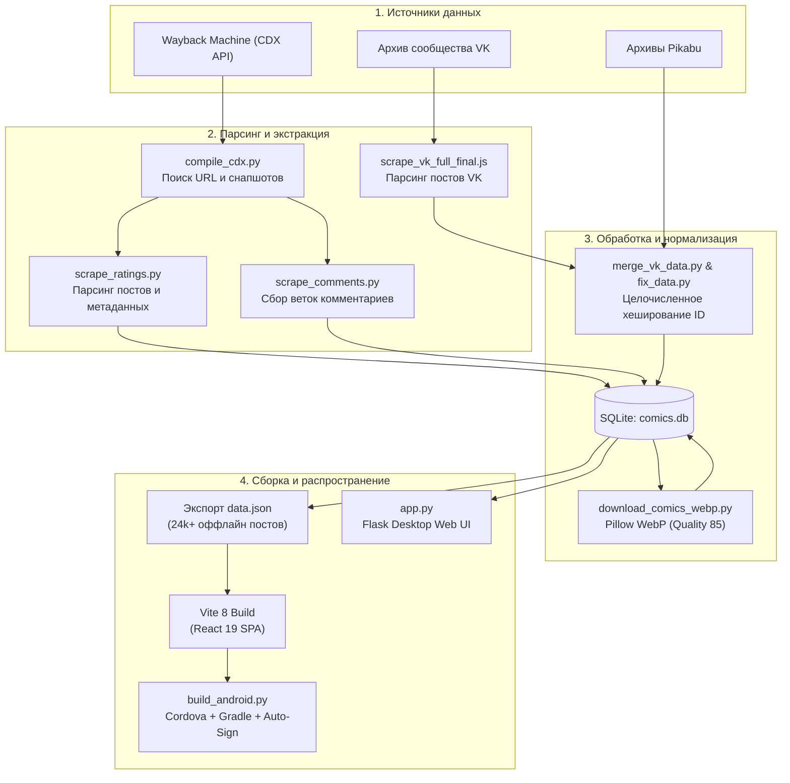

<br>

<p align="center">
  
</p>

<h1 align="center">Comicsbook.ru Archive & Museum</h1>

<p align="center">
  <b>Цифровой музей и автономный оффлайн-архив легендарного развлекательного портала рунета</b><br>
  <i>Восстановление истории, тысяч культовых комиксов, мемов и авторских комментариев эпохи 2011–2015 годов</i>
</p>

<p align="center">
  <a href="https://github.com/RandoTeam/comicsbook.ru-archive/releases"></a>
  <a href="#-поддержка-соло-разработчика--support-the-solo-developer"></a>
  
  <a href="LICENSE"></a>
</p>

<p align="center">
  
  
  
  
  
  
  
  
</p>

<br>

---

<br>

## 📌 Оглавление

1. [🏛 О проекте и миссия сохранения](#-о-проекте-и-миссия-сохранения)
2. [📦 Готовые сборки (Releases)](#-готовые-сборки-releases)
3. [⚡ Ключевые возможности](#-ключевые-возможности)
4. [🛠 Технологический стек и спецификации](#-технологический-стек-и-спецификации)
5. [🔄 Архитектурный пайплайн данных](#-архитектурный-пайплайн-данных)
6. [📂 Модульная структура репозитория](#-модульная-структура-репозитория)
7. [🚀 Руководство по запуску и сборке](#-руководство-по-запуску-и-сборке)
8. [🗺 Дорожная карта и точки доработки](#-дорожная-карта-и-точки-доработки)
9. [💖 Поддержка соло-разработчика / Support the Solo Developer](#-поддержка-соло-разработчика--support-the-solo-developer)
10. [📄 Лицензия и отказ от ответственности](#-лицензия-и-отказ-от-ответственности)

<br>

---

## 🏛 О проекте и миссия сохранения

**Comicsbook.ru Archive & Museum** — это комплексный цифровой архив и музей, созданный для сохранения наследия некогда крупнейшего русскоязычного портала веб-комиксов и мемов **Comicsbook.ru**, функционировавшего в период расцвета культуры яростных комиксов (Rage Comics), демотиваторов и мемов раннего рунета.

После закрытия сайта оригинальный контент оказался под угрозой полного исчезновения. Проект решает следующие ключевые задачи:
* **Глубокая реконструкция**: Извлечение десятков тысяч постов, снимков страниц, оригинальных рейтингов, дат публикаций и древовидных веток комментариев из снимков Internet Archive Wayback Machine, официального сообщества ВКонтакте и архивных тредов.
* **100% автономность (Local-First)**: Мобильное приложение работает полностью автономно без подключения к сети. База данных и сжатая медиатека упакованы внутрь дистрибутива.
* **Современный UX с уважением к истории**: Возможность использовать новейший мобильный клиент на React 19 с плавной виртуализацией списков, либо запустить аутентичный настольный сервер на Flask, в точности повторяющий внешний вид оригинального веб-сайта.

<br>

---

## 📦 Готовые сборки (Releases)

Для комфортного просмотра архива на мобильных устройствах не требуется установка компиляторов или запуска скриптов сбора:

* Перейдите во вкладку **[Releases](https://github.com/RandoTeam/comicsbook.ru-archive/releases)**.
* Скачайте готовый релизный пакет **`comicsbook-release.apk`**.
* Установите на телефон (поддерживаются устройства на базе **Android 8.0 — Android 15+**). Все изображения и посты уже вшиты в приложение.

<br>

---

## ⚡ Ключевые возможности

| Функция | Описание реализации |
| :--- | :--- |
| **Оффлайн-режим (Zero-Network)** | Полный архив из **24 000+ постов** читается напрямую из локального JSON/SQLite хранилища. Приложение запускается мгновенно даже в авиарежиме. |
| **Высокопроизводительный Virtual Scroll** | Виртуализация ленты через библиотеку `react-virtuoso`. В DOM рендерятся только видимые карточки, обеспечивая стабильные 60/120 FPS без утечек памяти. |
| **Кастомизация интерфейса** | Поддержка трех тем оформления: **Светлая**, **Темная** и истинно черная **OLED** (для экономии батареи на AMOLED-дисплеях), а также настройка размера шрифта и компактного режима отображения. |
| **Менеджер пользовательских папок** | Создание собственных именованных папок в разделе «Избранное» для структурирования любимых комиксов. |
| **Встроенный ретро-плеер** | Интегрированный музыкальный проигрыватель с подборкой классических треков эпохи (5 треков в формате `.m4a`), фоновое воспроизведение и автопереключение. |
| **Экспорт и шеринг** | Сохранение любого комикса в нативную галерею устройства в 1 тап (`cordova-base64-to-gallery`) и копирование метаданных. |
| **История и кэш скролла** | Автоматическое сохранение точной позиции чтения и истории просмотренных постов между сессиями. |

<br>

---

## 🛠 Технологический стек и спецификации

### 1. Программный стек

```
┌─────────────────────────────────────────────────────────────────────────┐
│                          Клиентские платформы                           │
├────────────────────────────────────┬────────────────────────────────────┤
│     Android Application (SPA)      │     Desktop Local Web Server       │
│  React 19 • Vite 8 • Cordova 15   │    Python 3 • Flask • Jinja2       │
│  React Virtuoso • Oxlint           │    SQLite 3 • Vanilla CSS/JS       │
└────────────────────────────────────┴────────────────────────────────────┘
                                  ▲
                                  │
┌─────────────────────────────────┴───────────────────────────────────────┐
│                    Пайплайн данных и медиа-конвейер                     │
├─────────────────────────────────────────────────────────────────────────┤
│  Wayback Machine CDX API • Requests • BeautifulSoup4 • Playwright       │
│  Pillow (PIL) Image Processing • WebP Compression • Audio Transcoder    │
└─────────────────────────────────────────────────────────────────────────┘
```

* **Frontend SPA**: `React 19.2`, `React DOM 19.2`, `Vite 8.1`, `@vitejs/plugin-react 6.0`.
* **Виртуализация ленты**: `react-virtuoso 4.18` (расчет динамической высоты карточек, бесшовная прокрутка).
* **Мобильный контейнер**: `Apache Cordova 15.0 (Android Engine)`, плагины `cordova-plugin-statusbar`, `cordova-base64-to-gallery`, `cordova-plugin-android-permissions`, `cordova-plugin-ionic-webview`.
* **Локальный бэкенд**: `Python 3.10+`, `Flask`, `urllib3`, `requests`.
* **Линтинг и качество**: `Oxlint 1.69` (сверхбыстрый Rust-based линтер JavaScript/JSX).

### 2. Спецификация форматов медиа

* **Изображения (WebP Compression)**:
  * Все оригинальные файлы комиксов (`.jpg`, `.png`, `.gif`) конвертируются в формат **WebP** с помощью `Pillow` с параметром качества `quality=85`.
  * Данное решение позволило **сократить общий вес медиатеки более чем на 68%** без потери читаемости текстов в комиксах и сохранить исходное разрешение.
* **Аудиодорожки**:
  * Формат: **M4A (AAC)** с оптимизированным битрейтом для компактности и совместимости со стандартными декодерами Android WebView.

<br>

---

## 🔄 Архитектурный пайплайн данных

Полный цикл обработки исторического наследия сайта строится по детерминированной схеме:



### Этапы пайплайна:
1. **CDX Индексация (`compile_cdx.py`)**: Формирование карты доступных снимков `comicsbook.ru` в Internet Archive Wayback Machine.
2. **Сбор постов и комментариев (`scrape_ratings.py`, `scrape_comments.py`)**: Многопоточный обход страниц, парсинг заголовков, категорий, рейтинга, оригинальных авторов и древовидных комментариев.
3. **Оптимизация медиа (`download_comics_webp.py`)**: Скачивание оригиналов и потоковая конвертация в WebP с сохранением структуры путей.
4. **Нормализация ID (`merge_vk_data.py`, `fix_data.py`)**: Устранение строковых коллизий (приведение строковых `vk_...` идентификаторов к безопасным Integer-хешам для предотвращения багов сортировки `NaN` в JS-движках).
5. **Оркестрация сборки (`build_android.py`)**: Единый скрипт автоматической сборки React, переноса ассетов, создания Cordova-проекта, компиляции через Gradle и финализации подписанного `.apk`.

<br>

---

## 📂 Модульная структура репозитория

```
comicsbook/
├── react_app/                  # Исходный код мобильного клиента (React 19 + Vite 8)
│   ├── src/
│   │   ├── components/         # Компоненты: VirtualFeed, PostCard, BottomNav, Skeleton, Toast
│   │   ├── utils/              # Хелперы обработки изображений, кэширования и иконок
│   │   ├── App.jsx             # Корневой контроллер приложения и роутинг табов
│   │   ├── main.jsx            # Точка входа React
│   │   └── index.css           # Система стилей (Light / Dark / OLED темы)
│   └── package.json            # Зависимости SPA-клиента
│
├── cordova_app/                # Контейнер сборки под Android
│   ├── config.xml              # Настройки разрешений, ориентации и имени пакета
│   └── package.json            # Зависимости Cordova и плагины
│
├── assets/                     # Графические ассеты
│   ├── brand/                  # Логотипы и фирменные иконки проекта
│   └── support/                # QR-коды для поддержки разработчика
│
├── app.py                      # Локальный Flask сервер (ретро-интерфейс для ПК)
├── templates/                  # Jinja2 шаблоны классического интерфейса сайта
├── css/ & js/                  # Аутентичные стили и скрипты оригинального Comicsbook.ru
│
├── download_comics_webp.py     # Конвертер и загрузчик изображений в WebP
├── compile_cdx.py              # Парсер индексов Wayback Machine CDX
├── scrape_ratings.py           # Парсер постов и рейтингов
├── scrape_comments.py          # Парсер комментариев
├── merge_vk_data.py            # Утилита объединения архива сообщества VK
├── fix_data.py                 # Скрипт миграции и валидации структуры данных
├── build_android.py            # Главный скрипт автоматической сборки Android APK
│
├── README.md                   # Главная документация проекта
├── CHANGELOG.md                # История версий и изменений
├── DONATION.md                 # Полные реквизиты поддержки проекта
└── LICENSE                     # Лицензия MIT
```

<br>

---

## 🚀 Руководство по запуску и сборке

### 1. Требования к окружению
* **Node.js** `>= 18.0.0` и **npm**
* **Python** `>= 3.10`
* **Java Development Kit (JDK)** `17` (для компиляции Android APK)
* **Android SDK** с установленными Build Tools (для сборки через Cordova)

---

### 2. Запуск локального настольного сервера (Flask)
Для просмотра архива в аутентичном веб-интерфейсе 2011 года:

```bash
# Установка зависимостей
pip install Flask requests urllib3 pillow

# Запуск сервера
python app.py
```
Откройте браузер по адресу: `http://127.0.0.1:5000`.

---

### 3. Разработка мобильного фронтенда (React + Vite)
Для запуска и тестирования SPA-интерфейса в браузере:

```bash
cd react_app

# Установка зависимостей
npm install

# Запуск dev-сервера с hot-reload
npm run dev

# Проверка линтером Oxlint
npm run lint
```

---

### 4. Автоматическая сборка Android APK
Для компиляции релизного пакета запустите корневой оркестратор:

```bash
python build_android.py
```

Скрипт автоматически выполнит следующие шаги:
1. Вызовет сборку React фронтенда (`npm run build` в `react_app/`).
2. Экспортирует свежие данные базы `comics.db` в структуру `data.json`.
3. Синхронизирует скомпилированные ассеты и WebP-изображения с каталогом `cordova_app/www/`.
4. Скомпилирует релизный APK через Gradle (`gradlew assembleRelease`).
5. Автоматически подпишет APK релизным ключом и сгенерирует готовый файл `comicsbook-release.apk`.

<br>

---

## 🗺 Дорожная карта и точки доработки

### Реализовано (v1.0.0 – v1.0.4)
* [x] Полный сбор постов и комментариев с Wayback Machine.
* [x] Интеграция 24 000+ архивных постов сообщества ВКонтакте.
* [x] Полный перевод медиатеки в сжатый WebP (качество 85%).
* [x] Внедрение виртуализации списка `react-virtuoso` с устранением фризов скролла.
* [x] Реализация трех тем оформления (Light, Dark, OLED) и регулировки шрифтов.
* [x] Менеджер папок избранного и кэширование позиции скролла.
* [x] Встроенный ретро-аудиоплеер на 5 треков.
* [x] Автоматизация сборки и подписания релизного APK (`build_android.py`).

### Ближайшие точки доработки (v1.1.0)
* [ ] **Архитектурный рефакторинг `App.jsx`**:
  * Декомпозиция монолитного файла (~1600 строк) с вынесением модальных окон (`FolderModal`, `ContextMenuModal`, `FullscreenViewerModal`) в изолированные компоненты.
  * Вынесение логики плеера в кастомный хук `useAudioPlayer`.
* [ ] **Улучшение режима просмотра (Fullscreen Viewer)**:
  * Реализация плавного мультитач-зума (*pinch-to-zoom*) для чтения многопанельных комиксов с мелким текстом.
  * Поддержка свайп-жестов (влево/вправо) для быстрого перелистывания соседних комиксов.
* [ ] **Клиентский поисковый индекс**:
  * Замена линейной фильтрации массива `posts.filter()` на легковесный полнотекстовый индекс (MiniSearch / Fuse.js) для моментальной выдачи результатов при поиске по 24 000+ постов.
* [ ] **Оптимизация памяти (Chunking)**:
  * Чанкование `data.json` по категориям для снижения нагрузки на оперативную память бюджетных смартфонов.

### Планы на будущее (v2.0.0)
* [ ] **PWA & Offline Web**: Интеграция Service Worker для полноценной оффлайн-работы веб-версии на компьютерах и iOS без необходимости установки сторонних контейнеров.
* [ ] **Автоматизация CI/CD**: Настройка GitHub Actions Workflow для непрерывной сборки артефактов при пуше релизных тегов.

<br>

---

## 💖 Поддержка соло-разработчика / Support the Solo Developer

Этот проект создан, развивается и поддерживается **полностью в одиночку одним независимым разработчиком**. Архивация десятков тысяч постов, написание парсеров, конвертация гигабайтов графики в WebP, разработка мобильного приложения и регулярное исправление багов выполняются своими силами на чистом энтузиазме — **в память о культовом ресурсе рунета и для сохранения нашей общей цифровой истории**.

Если этот архив подарил вам чувство ностальгии, сохранил любимые мемы или вдохновил вас — ваша поддержка поможет покрыть расходы на серверы, тестовые физические Android-устройства и ускорит разработку новых версий.

<br>

### 💳 Прямые банковские переводы (Россия, СНГ, Казахстан)

* **Т-Банк Сбор** *(Россия и СНГ / Карты любых банков и СБП)*:  
  👉 **[https://www.tbank.ru/cf/9YuuZydrQlI](https://www.tbank.ru/cf/9YuuZydrQlI)**  
  *Быстрый перевод в 1 клик через Систему быстрых платежей (СБП) или банковскую карту. Категория «Подарки» (освобождено от налогообложения по ст. 217 НК РФ, защита 3D-Secure).*

* **Kaspi Bank** *(Казахстан и Центральная Азия)*:  
  📱 **`+7 707 390-30-49`**  
  *Прямой перевод через приложение Kaspi Gold по номеру телефона.*

<br>

### 🪙 Международная криптовалюта (Worldwide Direct Crypto)

*Децентрализованно, без посредников, работает по всему миру.*

| Актив | Сеть | Адрес кошелька |
| :--- | :--- | :--- |
| **USDT** | **TRC-20** | `TY1j2N8x4K7b9vL3mP5qR8sW2tU4xZ6y8A` |
| **Bitcoin (BTC)** | **Native SegWit** | `bc1qparlexsolodeveloperhardwarefund` |
| **Ethereum (ETH)** | **ERC-20** | `0xfca2fc261d4f23768a04ec49c3448278cdf17c2b` |

> Подробная информация, инструкции по безопасности и альтернативные реквизиты также доступны в отдельном файле **[DONATION.md](DONATION.md)**.

<br>

---

## 📄 Лицензия и отказ от ответственности

* Исходный код скриптов, парсеров, веб-сервера и мобильного приложения распространяется под свободной лицензией **[MIT](LICENSE)**.
* **Disclaimer**: Этот репозиторий является некоммерческим историко-культурным архивом. Графические материалы и тексты получены из публичных архивных веб-снимков. Проект не претендует на авторство оригинального пользовательского контента. При возникновении вопросов со стороны правообладателей или авторов обратитесь через раздел **Issues** для немедленного решения вопроса.
